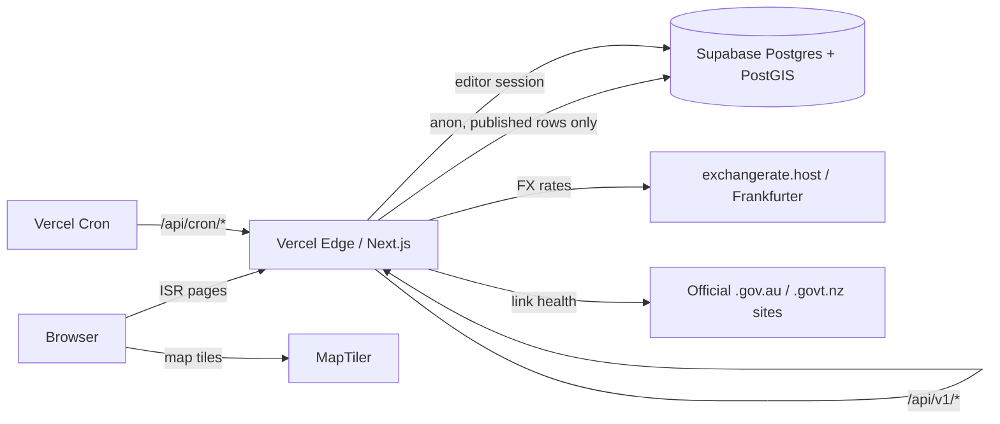

<div align="center">

# TravelAusNZ

**An editor-curated, car-free travel guide to Australia and New Zealand — built Thai-first, in Thai and English.**


*Edited, not aggregated.*

</div>

---

## Overview

TravelAusNZ helps independent travellers (28–55, trips of one to three weeks, mostly without a car) plan Australia and New Zealand. Every place, restaurant and route is chosen by editors, and every entity carries its **nearest public-transport stop and walking time** — the guide is designed around getting everywhere without driving.

The site is **content-heavy and read-mostly**: pages are statically generated and revalidated on publish, external data (exchange rates, official-link health) is pulled in by scheduled jobs, and no visitor request ever waits on a third-party API.

## Features

| Page | Route | What it does |
|---|---|---|
| **Destinations** | `/` | Hero slider, AU/NZ featured regions, curated journeys, a car-free route showcase, the dining edit, and search |
| **Interactive Map** | `/map` | MapLibre map with server-side clustering, layer toggles, a place drawer with opening hours and nearest stops, and a full keyboard-accessible list view |
| **Eat & Drink** | `/eat-drink` | Restaurants and bars filtered by city, price, drinks, atmosphere, diet and cuisine, with live facet counts and shareable URL filters |
| **Gallery** | `/gallery` | Masonry gallery filtered by region, type and season; every photo opens a lightbox backed by its place (best time, how to get there without a car, nearby dining) |
| **Money** | `/money` | Currency converter from seven home currencies to AUD/NZD, cross rate, rate trend, "what things cost" and a budget helper — all computed client-side from one rate snapshot |
| **Visa & Entry** | `/visa` | A three-question helper that runs entirely in the browser (answers are never sent or stored), permission types, timeline, document checklist and FAQ |
| **Admin** | `/admin` | Role-guarded CRUD for all content, media upload with mandatory credit and licence, publish-time cache revalidation, an audit log and a review queue |

Across every page:

- **Bilingual** — Thai (default) and English at `/th` and `/en`, with database content stored as `{ "th", "en" }` and an English fallback.
- **Light and dark themes** with no flash on load, and full `prefers-reduced-motion` support.
- **Accessibility** targeting WCAG 2.2 AA: visible focus rings, native dialogs with focus return, and a list alternative to the map.
- **SEO** — a sitemap index, `hreflang` alternates, canonicals, and JSON-LD (`TouristAttraction`, `Restaurant`, `BarOrPub`).
- **Privacy by design** — analytics events come from a fixed allow-list and drop anything resembling personal data.

## Tech stack

| Layer | Choice |
|---|---|
| Framework | Next.js 15 (App Router, server components, server actions), React 19, TypeScript |
| Styling | Tailwind CSS 4 with design tokens, Prompt typeface |
| i18n | next-intl 4 (`th`, `en`) |
| Database | Supabase Postgres with PostGIS and `pg_trgm`, row-level security on every table |
| Auth | Supabase Auth (email magic link, Google, Apple) |
| Storage | Supabase Storage, served through the Next.js image optimizer |
| Map | MapLibre GL with a MapTiler (or any MapLibre) style |
| Rate limiting | Upstash Redis |
| Jobs | Vercel Cron |
| Observability | Sentry, PostHog, Vercel Analytics |
| Testing | Vitest + Testing Library (unit, route and component tests), pgTAP (schema, RLS and SQL functions) |

## Architecture



- **Public pages** are server components that read published rows through a cookie-less Supabase client wrapped in `unstable_cache`, tagged per module (`home`, `map`, `venues`, `gallery`, `fx`, `entry`).
- **Publishing** in the admin calls `revalidateTag`, so new content appears without a redeploy.
- **Interactive parts** — the map, filters, converter and visa helper — are client components fed by the page's static payload or by cached `GET /api/v1/*` routes.
- **Writes** from the admin go through the editor's own session, so row-level security and audit triggers record who changed what.

### API

All endpoints return JSON. Errors use one shape: `{ "error": { "code", "message" } }`. Input is validated with Zod, and list endpoints use cursor pagination.

| Endpoint | Purpose |
|---|---|
| `GET /api/v1/home` | Home page payload for a country |
| `GET /api/v1/journeys`, `/journeys/:slug` | Curated itineraries |
| `GET /api/v1/search` | Places, regions and journeys (rate-limited) |
| `GET /api/v1/map/places` | Clusters below zoom 13, GeoJSON features above |
| `GET /api/v1/map/transit` | Lines and stations for a city |
| `GET /api/v1/places/:slug` | Place detail with up to three nearest stops |
| `GET /api/v1/venues`, `/venues/:slug` | Venue catalog with facet counts |
| `GET /api/v1/gallery` | Photos with their place summaries |
| `GET /api/v1/fx/latest`, `/fx/history`, `/fx/reference` | Rates, daily history, cost reference |
| `GET /api/v1/entry` | Entry rules, permission types, official links |
| `POST /api/v1/feedback` | "Report outdated info" (5 per hour per IP) |

Scheduled jobs (`vercel.json`) accept only `Authorization: Bearer $CRON_SECRET`:

| Job | Schedule (UTC) | Does |
|---|---|---|
| `/api/cron/fx-ingest` | hourly | Fetches rates (primary provider, then a keyless backup) and stores a snapshot |
| `/api/cron/fx-daily` | 00:10 daily | Rolls up daily closes and prunes old snapshots |
| `/api/cron/link-check` | 02:00 daily | Checks official government links and flags changed or broken ones for review |

## Project structure

```text
src/
  app/
    [locale]/(site)/   public pages: home, map, eat-drink, gallery, money, visa, login
    [locale]/admin/    role-guarded content admin
    api/v1/            public JSON API
    api/cron/          scheduled jobs
  components/          UI by feature (home, map, venues, gallery, money, visa, site, ui)
  lib/                 content loaders, API helpers, FX, entry rules, SEO, Supabase clients
  i18n/                next-intl routing and request config
messages/              th.json and en.json
supabase/
  migrations/          schema, RLS, functions and reference data
  tests/               pgTAP tests
  seed.sql             development sample content
design/                design artboards (reference only)
docs/                  implementation plans and gap report
```

## Getting started

### Prerequisites

- Node.js 22.22+, 24.15+ or 26+, and npm
- A hosted Supabase project for development. Docker is **not** needed: the Supabase CLI works against the linked project.

### 1. Install

```bash
npm install
cp .env.example .env.local
```

### 2. Configure `.env.local`

| Key | Purpose |
|---|---|
| `NEXT_PUBLIC_SUPABASE_URL`, `NEXT_PUBLIC_SUPABASE_ANON_KEY` | Supabase client |
| `SUPABASE_SERVICE_ROLE_KEY` | Server-only writes from jobs and the review queue — must be the real **service role** key |
| `UPSTASH_REDIS_REST_URL`, `UPSTASH_REDIS_REST_TOKEN` | Rate limiting |
| `NEXT_PUBLIC_SITE_URL` | Public origin for sitemaps and canonicals; **required** for production and preview builds |
| `NEXT_PUBLIC_MAP_STYLE_URL` | MapLibre style URL; when empty, development uses the MapLibre demo style |
| `EXCHANGERATE_HOST_KEY` | Primary FX provider; when empty, the keyless Frankfurter backup is used |
| `CRON_SECRET` | Bearer token for the cron routes; they reject every request while it is empty |
| `NEXT_PUBLIC_SENTRY_DSN`, `SENTRY_AUTH_TOKEN` | Error tracking (optional) |
| `NEXT_PUBLIC_POSTHOG_KEY`, `NEXT_PUBLIC_POSTHOG_HOST` | Product analytics (optional) |
| `SUPABASE_ACCESS_TOKEN`, `SUPABASE_DB_PASSWORD`, `SUPABASE_DB_URL` | Supabase CLI and `npm run test:db` |

### 3. Link Supabase and apply the schema

The CLI does not read `.env.local`, so export its two keys in your shell:

```bash
export SUPABASE_ACCESS_TOKEN=...
export SUPABASE_DB_PASSWORD=...
npx supabase link --project-ref <your-dev-project-ref>
npx supabase db reset --linked --yes
```

> [!WARNING]
> `db reset` wipes the linked database and re-applies every migration plus `supabase/seed.sql`. Run it only against a development project, and check `supabase/.temp/project-ref` first.

Reference data (regions, cities, currencies) lives in a migration, so it exists in every environment. `seed.sql` holds development-only sample content.

### 4. Run

```bash
npm run dev
```

Open <http://localhost:3000> — you are redirected to `/th`.

### Supabase dashboard (one-time)

1. **Authentication → Sign In / Providers:** enable Email, Google and Apple.
2. **Authentication → URL Configuration:** set the Site URL and allow `http://localhost:3000/**`.
3. **Promote an editor.** Sign in once so your profile exists, then run in the SQL editor:

   ```sql
   update public.profiles
   set role = 'editor'   -- or 'admin'
   where id = (select id from auth.users where email = 'you@example.com');
   ```

   Editors can open `/th/admin`.

## Scripts

| Command | Does |
|---|---|
| `npm run dev` | Development server on port 3000 |
| `npm run build` | Production build |
| `npm test` | Unit, route and component tests (Vitest) |
| `npm run test:db` | pgTAP tests against the linked database |
| `npm run db:types` | Regenerates `src/lib/supabase/database.types.ts` |
| `npm run lint` | ESLint |

## Deployment

The app targets **Vercel**. Set every key from `.env.local` in the project settings, including `NEXT_PUBLIC_SITE_URL` for the Preview environment. The hourly FX job needs a Vercel plan that allows hourly crons; on a daily-only plan, change its schedule in `vercel.json`.

## Roadmap

- **Phase 1** — Destinations, Map, Eat & Drink, Gallery, Money, Visa & Entry, admin, SEO. *Built, in final review.*
- **Phase 2** — Transport journey planner (OpenTripPlanner and fare rules), Signature Dishes, Prepare for Your Trip, newsletter.
- **Phase 3** — My Trip (day plans, transit legs, sharing, PDF and calendar export), more cities, offline support.

The full design lives in [`TravelAusNZ— Module & System Design.md`](./TravelAusNZ—%20Module%20&%20System%20Design.md), and the current gaps are tracked in [`docs/superpowers/plans/2026-10-25-gap-report.md`](./docs/superpowers/plans/2026-10-25-gap-report.md).

## Acknowledgement of Country

We acknowledge the Traditional Custodians of the lands and waters across Australia and Aotearoa New Zealand, and pay our respects to Elders past and present.

---

<div align="center">
<sub>Prices are shown in AUD and NZD and are indicative. Entry information is a guide only — always confirm on the official government site.</sub>
</div>
